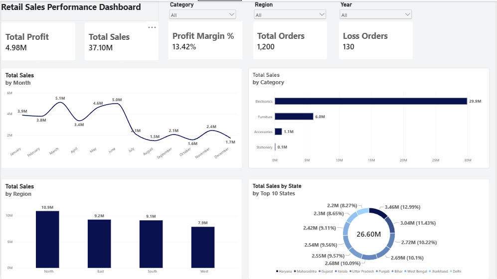
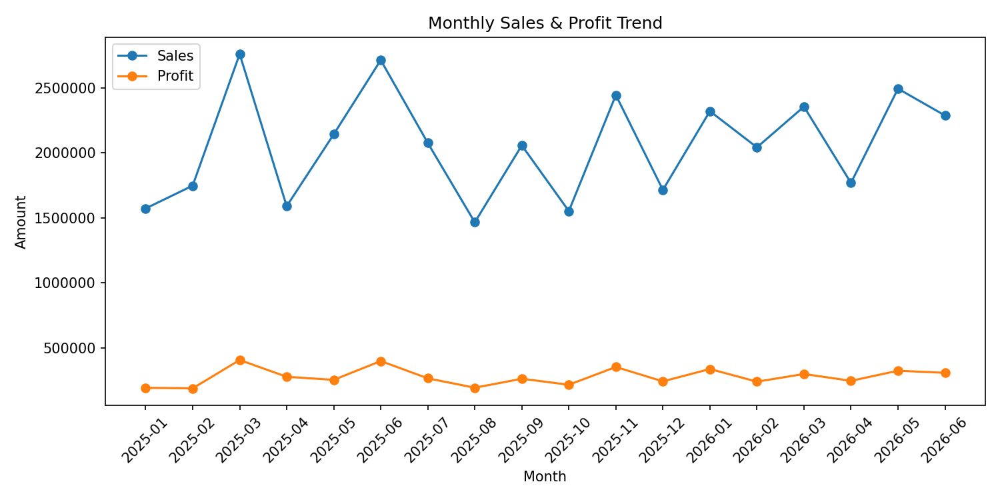
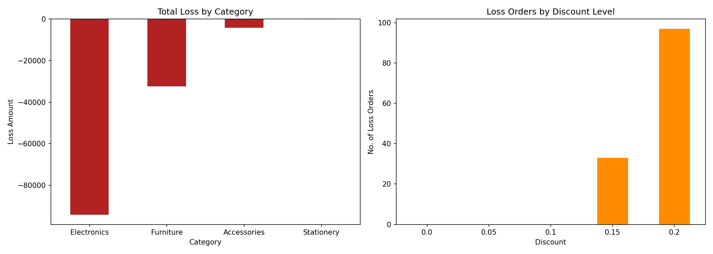
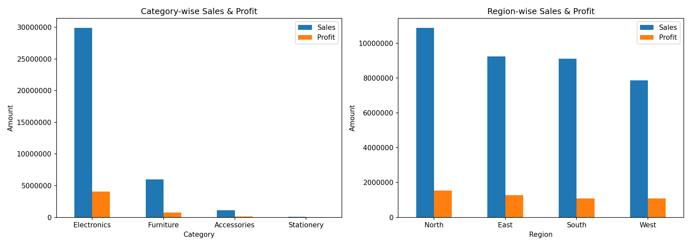
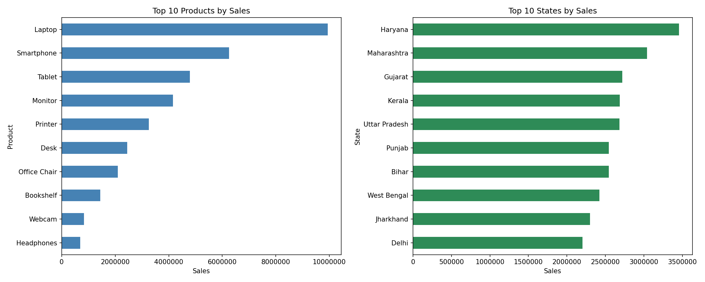

# Retail Sales Analytics: End-to-End Project

## Objective
Analyze retail sales data (1,200 orders, Jan 2025 to Jun 2026) to find top performers and the cause of loss-making orders.

## Tools Used
Excel (cleaning) | PostgreSQL (SQL analysis) | Python: pandas, matplotlib | Power BI (DAX, dashboard)

## Dashboard

## Key Insights
- Total Sales: 37.10M | Total Profit: 4.98M | Margin: 13.42%
- Electronics contributes ~79% of total sales
- Laptop is the top-selling product; Haryana is the top state
- 130 loss-making orders (10.83%), all at 15% to 20% discount (97 at 20%)
- Orders with 0% to 10% discount had zero losses

## Recommendation
Cap discounts at 10% on Electronics (Monitor, Laptop, Printer) to remove most losses while keeping sales volume.

## Project Structure
- `02_Excel_Cleaning`: cleaned dataset
- `03_SQL`: table creation + 10 analysis queries (window functions included)
- `04_Python`: data checks, trend, category/region, loss and top product analysis
- `05_PowerBI`: dashboard (.pbix, PDF, PNG)

## Python Charts

